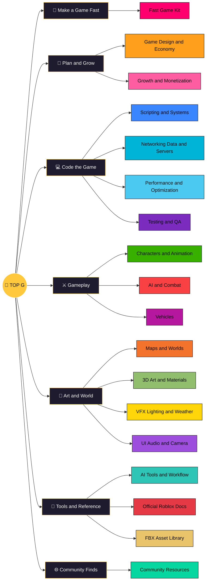

# 👑 TOP G VAULT
> [!topg] The Roblox game-dev brain in one place
> **3,978 notes** · **77 deep dives** · **10,040 FBX files** · **55 GB** · every topic has its own colour on the graph and in the sidebar.

## Start in 3 steps
1. Pick a coloured section below and open a **Hub**.
2. Open the **Graph view** (`Ctrl+G`): each colour is one topic.
3. Need models or animations? [[FBX Asset Library - Hub]].

## Vault map

## 🚀 Make a Game Fast

 Colour | Area | Notes | Deep dives | Open a hub
:-:|---|--:|--:|---
 | **Fast Game Kit** | 28 |  | [[Fast Game Kit - Hub\|Fast Game Kit]] · [[Genre Recipes - Hub\|Genre Recipes]] · [[Playbook - Hub\|Playbook]] · [[Starter Code - Hub\|Starter Code]]

## 🎯 Plan and Grow

 Colour | Area | Notes | Deep dives | Open a hub
:-:|---|--:|--:|---
 | **Game Design and Economy** | 118 | 3 | [[Foundations Planning - Hub\|Foundations Planning]] · [[Inventory Economy - Hub\|Inventory Economy]] · [[Story Quests Cinematics - Hub\|Story Quests Cinematics]]
 | **Growth and Monetization** | 124 | 10 | [[Analytics Discovery - Hub\|Analytics Discovery]] · [[Community Discord - Hub\|Community Discord]] · [[LiveOps Social - Hub\|LiveOps Social]] · [[Monetization - Hub\|Monetization]] · [[Publishing Release - Hub\|Publishing Release]] · [[Thumbnails - Hub\|Thumbnails]]

## 💻 Code the Game

 Colour | Area | Notes | Deep dives | Open a hub
:-:|---|--:|--:|---
 | **Scripting and Systems** | 110 | 8 | [[Math Geometry - Hub\|Math Geometry]] · [[Physics Ragdolls - Hub\|Physics Ragdolls]] · [[Procedural Generation - Hub\|Procedural Generation]] · [[Scripting - Hub\|Scripting]]
 | **Networking Data and Servers** | 73 | 9 | [[Data Backend - Hub\|Data Backend]] · [[Networking Security - Hub\|Networking Security]] · [[Server Engineering - Hub\|Server Engineering]]
 | **Performance and Optimization** | 72 | 6 | [[Optimization - Hub\|Optimization]] · [[Performance - Hub\|Performance]]
 | **Testing and QA** | 77 | 5 | [[Testing - Hub\|Testing]]

## ⚔️ Gameplay

 Colour | Area | Notes | Deep dives | Open a hub
:-:|---|--:|--:|---
 | **Characters and Animation** | 70 | 6 | [[Animation - Hub\|Animation]] · [[Characters Customization - Hub\|Characters Customization]]
 | **AI and Combat** | 88 | 9 | [[AI - Hub\|AI]] · [[Combat - Hub\|Combat]]
 | **Vehicles** | 74 | 4 | [[Vehicles - Hub\|Vehicles]]

## 🎨 Art and World

 Colour | Area | Notes | Deep dives | Open a hub
:-:|---|--:|--:|---
 | **Maps and Worlds** | 75 | 3 | [[Maps - Hub\|Maps]] · [[Terrain Vegetation - Hub\|Terrain Vegetation]]
 | **3D Art and Materials** | 78 | 3 | [[3D Modeling Blender - Hub\|3D Modeling Blender]] · [[Materials Textures - Hub\|Materials Textures]] · [[Visual Production Atlas - Hub\|Visual Production Atlas]]
 | **VFX Lighting and Weather** | 80 | 5 | [[Lighting - Hub\|Lighting]] · [[VFX - Hub\|VFX]] · [[Weather - Hub\|Weather]]
 | **UI Audio and Camera** | 89 | 4 | [[Accessibility Localization - Hub\|Accessibility Localization]] · [[Audio - Hub\|Audio]] · [[Camera Game Feel - Hub\|Camera Game Feel]] · [[UI UX - Hub\|UI UX]]

## 🧰 Tools and Reference

 Colour | Area | Notes | Deep dives | Open a hub
:-:|---|--:|--:|---
 | **AI Tools and Workflow** | 100 | 2 | [[Claude MCP AI Workflow - Hub\|Claude MCP AI Workflow]] · [[Git Version Control - Hub\|Git Version Control]] · [[Graph View Setup - Hub\|Graph View Setup]] · [[Obsidian Workflow - Hub\|Obsidian Workflow]] · [[Open Source Licensing - Hub\|Open Source Licensing]]
 | **Official Roblox Docs** | 2,232 |  | [[Official Roblox Docs - Hub\|Official Roblox Docs]]
 | **FBX Asset Library** | 10,040 FBX |  | [[FBX Asset Library - Hub\|FBX Asset Library]] · [[Asset Licenses and Credits\|Asset Licenses and Credits]]

## 🌐 Community Finds

 Colour | Area | Notes | Deep dives | Open a hub
:-:|---|--:|--:|---
 | **Community Resources** | 318 |  | [[Characters Avatars and UGC - Hub\|Characters Avatars and UGC]] · [[Free Animations - Hub\|Free Animations]] · [[Free Tools and Assets - Hub\|Free Tools and Assets]] · [[Free VFX and FX - Hub\|Free VFX and FX]] · [[Maps Worlds and Level Design - Hub\|Maps Worlds and Level Design]] · [[Open Source Games - Hub\|Open Source Games]] · [[Performance and Security - Hub\|Performance and Security]] · [[Reddit Game Design and Growth - Hub\|Reddit Game Design and Growth]] · [[Reddit Scripting and Systems - Hub\|Reddit Scripting and Systems]] · [[Testing QA and DevOps - Hub\|Testing QA and DevOps]] · [[Vehicles and Physics - Hub\|Vehicles and Physics]]

## Start Here notes
[[Top G Vault - Home]] (graph centre) · [[TDOD Roblox Master Vault — Start Here]] · [[Legendary Release Standard]] · [[Master Coverage Matrix]] · [[Resume Note]]

## How it's organised
- `NN Area / Topic / note`: every topic folder has a **Hub** note and, where written, a `Deep Dives` subfolder.
- Colours: the area colour is on its folder and on every note's headings; each topic has its own colour on the graph.
- New notes go to `00 Inbox`. Licenses and credits: [[Asset Licenses and Credits]].

## Speed settings (nothing deleted)
- The big **Graph view** hides the 2,232 Official Roblox Docs notes by default (they hold 70k of the vault's 75k links). To show them: Graph view → Filters → clear the search box. Each docs page still has its own local graph.
- Docs images and the 4K Pro pack are left out of search and the quick switcher (Settings → Files and links → Excluded files). They still open and embed normally.

<!-- TG_CK_START -->
## Community Knowledge

70 sourced notes added 2026-10-25.

- [[Beginner to Shipping Roadmap]]
- [[Build - Arena Shooter Weekend - Server-Checked Blaster, Respawns and Kills]]
- [[Build - Battlegrounds Weekend - Four-Hit M1 Combo and One Ability]]
- [[Build - Escape Room Weekend - Five Puzzles, Gates and a Timer]]
- [[Build - Hangout Weekend - Showcase Space, Seats, Music and a Synced Dance Floor]]
- [[Build - Horror Escape Weekend - One Monster, Three Rooms, One Exit]]
- [[Build - Idle Clicker Weekend - Click, Generators, Cost Curves and Offline Cash]]
- [[Build - Minigame Party Weekend - Round Loop and Three Plug-In Minigames]]
- [[Build - Obby Weekend - 30 Stages, Obstacle Tags and a Skip Button]]
- [[Build - Pet Collector Weekend - Eggs, Shown Odds, Follow Pets and Saving]]
- [[Build - Racing Weekend - One Track, Checkpoints and Three Laps]]
- [[Build - Roleplay Town Weekend - Three Jobs, Paychecks and a House]]
- [[Build - Simulator Weekend - Click, Collect, Sell, Upgrade]]
- [[Build - Survival Weekend - Gather, Craft and Place a Wall]]
- [[Build - Tower Defense Weekend - One Path, Three Towers, Ten Waves]]
- [[Build - Tycoon Weekend - Plot Claim, Button Ladder and Saved Purchases]]
- [[Client and Server in Plain Words]]
- [[Common Beginner Mistakes and Their Fixes]]
- [[Debugging Basics - Output, print, warn and Breakpoints]]
- [[Events and Connections for Beginners - Connect, Once, Wait and Debounce]]
- [[Explorer, Properties and Toolbox - Beginner Field Guide]]
- [[First Badge - Award on Achievement]]
- [[First Character Tweaks - WalkSpeed, JumpHeight, Health and Sprint]]
- [[First DataStore Save - Load, Save, Leave and Shutdown]]
- [[First GUI Button - ScreenGui, TextButton and Activated]]
- [[First Interaction with ProximityPrompt]]
- [[First Leaderboard with leaderstats]]
- [[First Moving Part with TweenService]]
- [[First Obby in 30 Minutes]]
- [[First RemoteEvent - Button on the Client, Reward on the Server]]
- [[First Round Loop - Intermission, Countdown and Winners]]
- [[First Shop - Selling a Game Pass and Opening the Built-in Shop]]
- [[First Sound - Background Music and a Click Sound]]
- [[First Team Game - Teams and SpawnLocations]]
- [[First Tool - A Sword or Flashlight You Can Equip]]
- [[First Tycoon Dropper - Dropper, Conveyor and Collector]]
- [[Install Studio and Your First Hour - Interface Tour]]
- [[Learning Resources - Official Courses and DevForum Categories]]
- [[Luau Basics Cheat Sheet - Variables, Tables, Loops, Functions]]
- [[Packages for Beginners - Reuse One Asset Everywhere]]
- [[Part Properties Every Beginner Must Know]]
- [[Publishing Your First Experience - 2026 Release Checklist]]
- [[Roblox Glossary for New Developers]]
- [[Saving and Version History - Never Lose a Place]]
- [[Starter - First Bug Hunt - A Worked Example from Symptom to Fix]]
- [[Starter - First Chasing Enemy - Nearest Player, Touch Damage and a Leash]]
- [[Starter - First Class with Metatables - One Blueprint, Many Objects]]
- [[Starter - First ClickDetector - Click a Part to Toggle a Light]]
- [[Starter - First Key Press - UserInputService, ContextActionService and Input Actions]]
- [[Starter - First Level and XP System - Level-Up Formula and XP Bar]]
- [[Starter - First ModuleScript and Code Organization]]
- [[Starter - First NPC Speech Bubble - DisplayBubble and Greeting Lines]]
- [[Starter - First Patrol NPC - Waypoints with MoveTo and MoveToFinished]]
- [[Starter - First Player Lifecycle - PlayerAdded, CharacterAdded, Died and Leaving]]
- [[Starter - First Spawner - Templates in ServerStorage, Clone and Cleanup]]
- [[Starter - First SurfaceGui Sign - Text on Parts and Clickable Screens]]
- [[Starter - First Tags and Attributes - One Script for Every Kill Brick]]
- [[Starter - First pcall - Handling Calls That Can Fail]]
- [[Starter - Models That Hold Together - Anchored, Welds, PrimaryPart and PivotTo]]
- [[Starter - Reading the API Reference - Inheritance, Members and Tags]]
- [[Starter - Scoping Your First Real Game - One Loop and a Cut List]]
- [[Starter - Using AI Assistants Safely for Roblox Code]]
- [[Starter - Your First Custom Assets - Images, Meshes and the Asset ID Mix-Up]]
- [[Studio Keyboard Shortcuts Cheat Sheet]]
- [[Studio Testing Modes for Beginners - Test, Run and Server and Clients]]
- [[Team Create for Beginners - Collaborators, Live Scripting and Drafts]]
- [[The Data Model and Finding Objects - GetService, FindFirstChild, WaitForChild]]
- [[Where Scripts Go - Containers, Script Types and RunContext]]
- [[Your First Luau Script - Step by Step]]
- [[Your First Week of Analytics - Which Numbers to Read First]]
<!-- TG_CK_END -->
