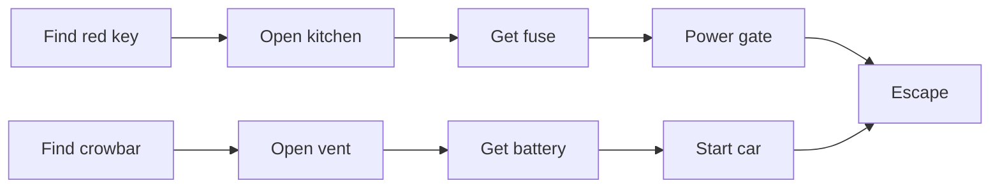

# Puzzle Dependency Charts - Keys, Locks and Gates

Piggy-style chapters, escape rooms and story obbies are all built on the same skeleton: **you need X to get Y**. Find the key, open the door, get the wrench, fix the generator, power the gate, escape. When this skeleton is badly shaped, players hit dead ends, wander with nothing to do, or solve everything in one straight line. Ron Gilbert (Monkey Island) designed with **puzzle dependency charts** and explained the method on his Grumpy Gamer blog in August 2014. It is the single most useful planning tool for a Roblox puzzle-horror chapter, and it costs nothing but a whiteboard.

## What the chart is (and is not)

- Each **node** is a puzzle step or a goal ("Basement door open").
- Each **arrow** points from a step to what it *unlocks*. A node with two arrows coming in needs both.
- Gilbert stresses it is **not a flow chart**. It shows *dependency*, not the order a player will actually do things in. Flow charts help you solve a game; dependency charts help you design one.

## How to draw one

1. **Start at the end and work backwards.** "Players escape through the garage." What does that need? "Garage door open" and "car battery installed". What does each of those need? Keep going until every leaf is something the player can do with no prerequisite.
2. Design from **goals**, not hiding places. Gilbert's advice: start from "the player needs to get into the basement", not "where shall I hide a key".
3. Lay it out **left to right** (Gilbert's preference) so it fits a wall or a wide screen.
4. Use a tool that **auto-lays out** the graph. Gilbert used OmniGraffle (Graphviz-based). Free options: Graphviz itself, Mermaid in an Obsidian note, or Puzzlon, a browser tool inspired by his post.



## Shapes to look for

- **Bushy diamonds (good).** Gilbert describes healthy charts as expanding and contracting: one solution opens two or three parallel puzzles, which narrow back to one, which opens the next set. Parallel puzzles mean a stuck player always has something else to try.
- **Long thin lines (bad).** Pure linear chains feel like chores. Gilbert is blunt that linear adventure games are the worst kind.
- **Bottlenecks.** A single node everything passes through. Use them on purpose to end an **act** (a chapter's midpoint), where Gilbert likes to close a set of puzzles so players feel progress and can drop used items.
- **Dead ends.** A required item that can be used up, lost or locked away. Gilbert names these as a major flaw of Maniac Mansion, designed without such charts.

A 2015 Game Developer article on Zynga narrative designer Christy Marx's mobile work gives the same warning from a different angle: avoid making all tasks depend on one locked resource, because players get stuck for a long time.

## Roblox-specific rules

- **Multiplayer splits work.** A bushy chart lets a party of 4 split up: one hunts the fuse while another opens the vent. In a straight line, three players wait.
- **Items respawn or are shared.** If the player carrying the key leaves the server or dies, the key must return to its spawn or drop where they died. Otherwise the chart now has a dead end.
- **Server-authoritative locks.** The server checks the player has the item before opening anything. A client "door open" request with no check is the first exploit in every escape game.
- **Data, not hard-coding.** Store the chart as a table so designers can change it:

```lua
local Puzzles = {
	KitchenDoor = {needs = {"RedKey"}, gives = {"Fuse"}},
	Vent        = {needs = {"Crowbar"}, gives = {"Battery"}},
	Gate        = {needs = {"Fuse"}, opens = "GatePath"},
	Car         = {needs = {"Battery"}, opens = "GarageExit"},
}
```

Validate it in a test: every `needs` item must be `given` somewhere, and nothing may be needed before it can be reached.

## Checklist for a chapter

- [ ] Chart drawn backwards from the escape.
- [ ] At least two open puzzles at almost every moment.
- [ ] One deliberate bottleneck at the midpoint.
- [ ] No item can be permanently lost.
- [ ] Each lock has a visible "you need..." message ([[Story - Puzzle Hint Systems - Tiered Nudges, Timers and Diegetic Clues]]).

## Related
[[Story Quests Cinematics - Hub]] · [[Quest Objective Framework]] · [[Case Study - Piggy]] · [[Environmental Storytelling - What Happened Here]]
