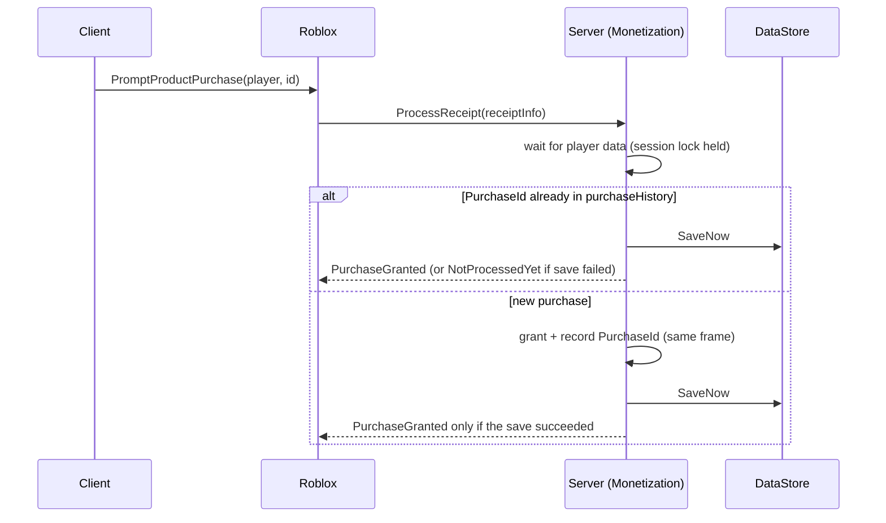

# Starter Code - 04 Monetization - Passes and ProcessReceipt

## Why this matters
A buyer who pays and gets nothing files a support ticket (or a chargeback); a buyer who gets the grant twice breaks your economy. Both come from a `ProcessReceipt` that answers `PurchaseGranted` before the grant is safely saved, or that cannot tell a retry from a new purchase.
This module grants each developer product exactly once and caches pass ownership so perks are a free lookup.

## How a developer-product purchase flows



Documented behaviour this design relies on (official `MarketplaceService` docs):

- `ProcessReceipt` runs for unresolved purchases when a purchase completes, when a successful prompt appears, and when the user joins a server. Set it **once**, in one server script, for all products.
- There is **no time-based retry**: after `NotProcessedYet` it is called again only on the user's next purchase attempt or when they rejoin. There is **no timeout**: the callback may yield as long as needed.
- The callback for one purchase **can run on two servers at once** if the user joins a second server before the first returns. The session lock makes this safe: the second server cannot load the data, so it answers `NotProcessedYet`.
- Returning `PurchaseGranted` can still fail to be recorded, so the same receipt can come back. The `PurchaseId` check turns that into "save and confirm", never a second grant.
- `PromptProductPurchaseFinished` does **not** mean a purchase succeeded; never grant from it.
- Pass checks: `UserOwnsGamePassAsync(userId, passId)` is cached by the engine and refreshed when `PromptGamePassPurchaseFinished` fires; on the server, that event's `wasPurchased` reflects the final outcome.

## The code

`Source/src/server/Services/Monetization.luau`

```lua
--!strict
-- Monetization: pass ownership cache + developer products with an idempotent ProcessReceipt.
-- Receipt rule: grant -> record PurchaseId in the save -> save succeeds -> PurchaseGranted.
-- Anything else returns NotProcessedYet, and Roblox delivers the receipt again later
-- (next purchase attempt or next join), where the PurchaseId check stops a double grant.

local MarketplaceService = game:GetService("MarketplaceService")
local Players = game:GetService("Players")
local ReplicatedStorage = game:GetService("ReplicatedStorage")

local GameConfig = require(ReplicatedStorage.Shared.GameConfig)
local Remotes = require(ReplicatedStorage.Shared.Remotes)
local PlayerData = require(script.Parent.PlayerData)
local Currency = require(script.Parent.Currency)
local Analytics = require(script.Parent.Analytics)

local PASS_ATTRIBUTE_PREFIX = "Pass_" -- player:GetAttribute("Pass_VIP") is readable on the client
local RECEIPT_DATA_WAIT = 60 -- seconds to wait for a joining player's data before giving up

local passKeyById: { [number]: string } = {}
local productById: { [number]: GameConfig.ProductInfo } = {}
for _, pass in GameConfig.GamePasses do
	if pass.Id ~= 0 then
		passKeyById[pass.Id] = pass.Key
	end
end
for _, product in GameConfig.Products do
	if product.Id ~= 0 then
		productById[product.Id] = product
	end
end

local ownedPasses: { [Player]: { [string]: boolean } } = {}

local Monetization = {}

----------------------------------------------------------------------
-- Passes
----------------------------------------------------------------------

local function setPassOwned(player: Player, passKey: string)
	local owned = ownedPasses[player]
	if not owned then
		owned = {}
		ownedPasses[player] = owned
	end
	owned[passKey] = true
	player:SetAttribute(PASS_ATTRIBUTE_PREFIX .. passKey, true)
end

local function checkPass(player: Player, passKey: string, passId: number)
	for attempt = 1, 3 do
		local ok, result = pcall(MarketplaceService.UserOwnsGamePassAsync, MarketplaceService, player.UserId, passId)
		if ok then
			if result == true and player.Parent == Players then
				setPassOwned(player, passKey)
			end
			return
		end
		warn(("[Monetization] pass check %s attempt %d failed: %s"):format(passKey, attempt, tostring(result)))
		task.wait(attempt * 2)
	end
end

-- Cached: safe to call every frame. False until the join-time check finishes.
function Monetization.OwnsPass(player: Player, passKey: string): boolean
	local owned = ownedPasses[player]
	return owned ~= nil and owned[passKey] == true
end

----------------------------------------------------------------------
-- Developer products
----------------------------------------------------------------------

-- Grant handlers must NOT yield: the PurchaseId check, the grant and the record must happen
-- in one go. Add special products here; by default a product grants its Coins.
type GrantHandler = (player: Player, product: GameConfig.ProductInfo) -> ...any

local customHandlers: { [string]: GrantHandler } = {
	-- Example: Coins500 = function(player, product) ... end,
}

local function defaultGrant(player: Player, product: GameConfig.ProductInfo)
	local ok = Currency.Add(player, product.Coins, Enum.AnalyticsEconomyTransactionType.IAP.Name, product.Key)
	if not ok then
		error("Currency.Add failed for " .. product.Key)
	end
end

local function processReceipt(receiptInfo: { [string]: any }): Enum.ProductPurchaseDecision
	local userId = receiptInfo.PlayerId
	local productId = receiptInfo.ProductId
	local purchaseId = receiptInfo.PurchaseId
	if type(userId) ~= "number" or type(productId) ~= "number" or type(purchaseId) ~= "string" then
		return Enum.ProductPurchaseDecision.NotProcessedYet
	end

	local player = Players:GetPlayerByUserId(userId)
	if not player then
		return Enum.ProductPurchaseDecision.NotProcessedYet -- redelivered when they next join
	end

	-- Receipts arrive on join, often before data has loaded: wait for it.
	local session = PlayerData.AwaitLoaded(player, RECEIPT_DATA_WAIT)
	if not session then
		return Enum.ProductPurchaseDecision.NotProcessedYet
	end

	-- Already granted (for example the save succeeded but Roblox never recorded our answer):
	-- do not grant again, just make sure it is saved.
	if PlayerData.HasPurchase(session, purchaseId) then
		return if PlayerData.SaveNow(player)
			then Enum.ProductPurchaseDecision.PurchaseGranted
			else Enum.ProductPurchaseDecision.NotProcessedYet
	end

	local product = productById[productId]
	if not product then
		warn("[Monetization] no product configured for id " .. productId)
		return Enum.ProductPurchaseDecision.NotProcessedYet
	end

	local handler: GrantHandler = customHandlers[product.Key] or defaultGrant
	local granted, err = pcall(handler, player, product)
	if not granted then
		warn("[Monetization] grant failed for " .. product.Key .. ": " .. tostring(err))
		return Enum.ProductPurchaseDecision.NotProcessedYet
	end
	PlayerData.RecordPurchase(session, purchaseId) -- same frame as the grant

	if session.temporary then
		warn("[Monetization] Studio temporary data: purchase granted but NOT saved")
	elseif not PlayerData.SaveNow(player) then
		-- Grant + PurchaseId stay in memory; the next delivery sees the id and only re-saves.
		return Enum.ProductPurchaseDecision.NotProcessedYet
	end

	Remotes.Server.Fire("Notify", player, ("Thanks! +%d %s"):format(product.Coins, GameConfig.Currency.Name))
	return Enum.ProductPurchaseDecision.PurchaseGranted
end

----------------------------------------------------------------------
-- Start
----------------------------------------------------------------------

function Monetization.Start()
	Remotes.Server.Declare("Notify")

	local function onPlayerAdded(player: Player)
		for passId, passKey in passKeyById do
			task.spawn(checkPass, player, passKey, passId) -- concurrent calls are batched by the engine
		end
	end
	Players.PlayerAdded:Connect(onPlayerAdded)
	for _, player in Players:GetPlayers() do
		onPlayerAdded(player)
	end
	Players.PlayerRemoving:Connect(function(player: Player)
		ownedPasses[player] = nil
	end)

	-- Server-side, wasPurchased reflects the final outcome (MarketplaceService docs).
	MarketplaceService.PromptGamePassPurchaseFinished:Connect(function(player: Player, gamePassId: number, wasPurchased: boolean)
		if not wasPurchased then
			return
		end
		local passKey = passKeyById[gamePassId]
		if passKey then
			setPassOwned(player, passKey)
			Analytics.Custom(player, "PassBought", 1, passKey)
			Remotes.Server.Fire("Notify", player, "Pass unlocked: " .. passKey)
		end
	end)

	-- Set exactly once, in one server Script context, for ALL developer products.
	MarketplaceService.ProcessReceipt = processReceipt
end

return Monetization
```

## How to use

1. Create passes and developer products in the Creator Dashboard (**Monetization**), then paste their IDs into `GameConfig.GamePasses` / `GameConfig.Products`. A pass ID is the pass's own ID, not an asset ID or product ID.
2. **Pass perks:** `Monetization.OwnsPass(player, "VIP")` on the server (cached, free to call). The client reads the replicated attribute `player:GetAttribute("Pass_VIP")` for UI only.
3. **Coin packs:** set `Coins` on the product; the default handler adds them with transaction type `IAP`.
4. **Anything else** (a revive, a nuke, a pet): add a handler to `customHandlers`, keyed by the product `Key`. It must not yield and must only change in-memory data (use `Currency`, set fields, mark dirty). Throw an error if it cannot grant; the receipt then stays unresolved.
5. **Prompting:** the client calls `MarketplaceService:PromptProductPurchase(player, id)` or `PromptGamePassPurchase(player, id)` (see `ShopPanel` in note 08). The client never grants anything.

**Newer alternative:** the docs now also list `MarketplaceService:BindReceiptHandler(Enum.ReceiptType.DeveloperProduct, handler, filter?)`, whose handler returns `Enum.ReceiptDecision.Processed` / `NotProcessedYet`. Bound handlers take precedence and unmatched receipts fall through to `ProcessReceipt`, so you can migrate one product at a time. The kit uses `ProcessReceipt` because it is the long-standing, fully documented path; the same idempotency rules apply to both.

## Common mistakes

- **Returning `PurchaseGranted` before the save.** If the server dies, the player paid and the grant is gone, and Roblox will never ask again.
- **No `PurchaseId` history.** Every retry (rejoin, second server) grants again.
- **Setting `ProcessReceipt` in more than one script.** Only the last assignment wins; the other products silently stop working.
- **Granting from `PromptProductPurchaseFinished`** or from a client remote. Neither proves payment.
- **Returning `NotProcessedYet` forever for an unknown product ID** (deleted or test product). Those receipts stay unresolved; they are not refunded. Keep every product you ever sold in `GameConfig.Products`.
- **Re-checking `UserOwnsGamePassAsync` every frame or on every hit.** Use the cache (`OwnsPass`).
- **Hard-coding Robux prices in UI text.** Prices can change with price tests or regional pricing; the shop reads `PriceInRobux` from `GetProductInfoAsync`.
- **Selling random rewards without disclosure.** Paid random items need odds shown and policy checks ([[Paid Random Items, Odds Disclosure and PolicyService]]).

## Checklist

- [ ] Every product and pass ID in `GameConfig` is real (no zeros left for things you sell).
- [ ] Test purchase in a published test place: coins arrive once, the toast shows, rejoin does not grant again.
- [ ] Kill the server right after buying (shut down from the dashboard): on rejoin the purchase is granted exactly once.
- [ ] Buy a pass in game: perk works without rejoining; rejoin: still owned.
- [ ] Only one place assigns `ProcessReceipt` (search the project).
- [ ] Product types match the decision guide ([[Passes vs Developer Products vs Subscriptions - 2026 Decision Guide]]).

**Related:** [[Starter Code - Hub]] · [[Recipe - Developer Product Shop with Safe ProcessReceipt]] · [[Purchase Fulfillment and Receipt Reliability]] · [[Save and Purchase Reliability Lab]] · [[Managed Pricing, Price Tests and Regional Pricing]] · [[MarketplaceService]] · [[Developer Products]] · [[Passes]]
