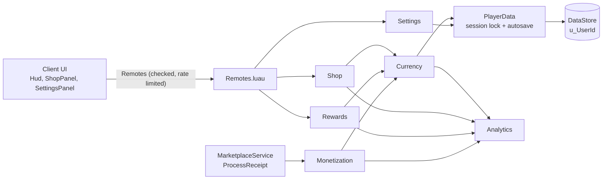

# Starter Code - Hub

## Why this matters
Every Roblox game needs the same plumbing: saves that never dupe or wipe, currency, purchases that are never lost, safe remotes, analytics, daily rewards, codes, a HUD, a shop and settings.
This kit is that plumbing as one Rojo project you drop in once and reskin per game, so day one goes to your game loop instead of rebuilding data and monetization again.

> [!topg] What you get
> A working starter place in `16 Fast Game Kit/Source` (Rojo layout, 18 `.luau` files, all `--!strict`), plus one note per module with the full code, how to use it, common mistakes and a checklist. Change two config files and your IDs, and it is your game's backbone.

## Build order

Read and install in this order. Each step only depends on the ones above it.

| # | Note | Files | What it gives you |
|---|---|---|---|
| 1 | [[Starter Code - 01 Project Layout and Bootstrap]] | `default.project.json`, `Bootstrap.server.luau`, `GameConfig.luau`, `ServerConfig.luau` | Folder layout, one server Script that starts services in order, all per-game settings in two files |
| 2 | [[Starter Code - 02 PlayerData Session-Locked Saves]] | `PlayerData.luau`, `DataTemplate.luau` | Session locking, retries with backoff, autosave, BindToClose flush, versioned schema and migrations |
| 3 | [[Starter Code - 03 Leaderstats and Currency]] | `Currency.luau`, `Shop.luau` | Server-authoritative add/spend, leaderstats, a coin shop |
| 4 | [[Starter Code - 04 Monetization - Passes and ProcessReceipt]] | `Monetization.luau` | Pass ownership cache, idempotent developer-product receipts |
| 5 | [[Starter Code - 05 Remotes Layer]] | `Remotes.luau` | Remotes created by name, argument checks, per-player rate limits |
| 6 | [[Starter Code - 06 Analytics Events]] | `Analytics.luau` | Custom, economy, funnel and onboarding event wrappers with budget guards |
| 7 | [[Starter Code - 07 Daily Reward and Codes]] | `Rewards.luau` | Daily streak, redeemable codes, playtime coins (2x with VIP) |
| 8 | [[Starter Code - 08 Client UI - HUD, Shop and Button Tweens]] | `ClientMain.client.luau`, `Ui.luau`, `ButtonTween.luau`, `Hud.luau`, `ShopPanel.luau` | Scale-based, safe-area-aware HUD, shop panel and reusable button feedback |
| 9 | [[Starter Code - 09 Settings and SoundGroups]] | `Settings.luau`, `SettingsPanel.luau` | Music and SFX volume through SoundGroups, saved in player data |
| 10 | [[Starter Code - 10 Reskin Checklist]] | (none) | What to change for a new game, in about 30 minutes |

## The project at a glance

```text
Source/
  default.project.json            Rojo: maps folders to services, creates SoundGroups
  src/
    shared/      -> ReplicatedStorage.Shared   (clients can read these)
      GameConfig.luau               names, IDs, prices, rewards, theme
      Remotes.luau                  remote layer (server + client API)
    server/      -> ServerScriptService.Server (never replicated)
      Bootstrap.server.luau         the only server Script
      ServerConfig.luau             codes, data store name (secret values)
      Services/
        Analytics.luau  PlayerData.luau  DataTemplate.luau  Currency.luau
        Shop.luau  Monetization.luau  Rewards.luau  Settings.luau
    client/      -> StarterPlayerScripts.Client
      ClientMain.client.luau        the only LocalScript
      UI/        Ui.luau  ButtonTween.luau
      Controllers/  Hud.luau  ShopPanel.luau  SettingsPanel.luau
```

## How the pieces talk



## How it was checked

- Every engine API, signature and enum item was checked against the vault's mirror of the official docs ([[Official Roblox Docs - Hub]]): `MarketplaceService`, `AnalyticsService`, `GlobalDataStore`, `DataStoreService`, `DataModel`, `RemoteEvent`, `ScreenGui`, `SoundGroup`, `TweenService` and the enums used.
- All 18 files compile with the official Luau compiler, have 0 syntax errors in `luau-analyze`, and type-check clean (0 errors, 0 lint warnings) with `luau-lsp analyze` using the Roblox type definitions and a Rojo sourcemap, under both the old and the new type solver. `rojo build` of the project succeeds.
- What a type checker cannot prove (data store behaviour under load, real purchases) still needs your live test pass: see the checklist in each note and [[Release Readiness Runbook 2026]].

## Related

[[Fast Game Kit - Hub]] · [[Genre Recipes - Hub]] · [[Playbook - Hub]] · [[Rojo, VS Code and luau-lsp - Local Setup from Zero]] · [[Module Architecture for a 50k-Line Roblox Game]] · [[DataStore Session Locking, Retries, Versioning and Erasure]]
