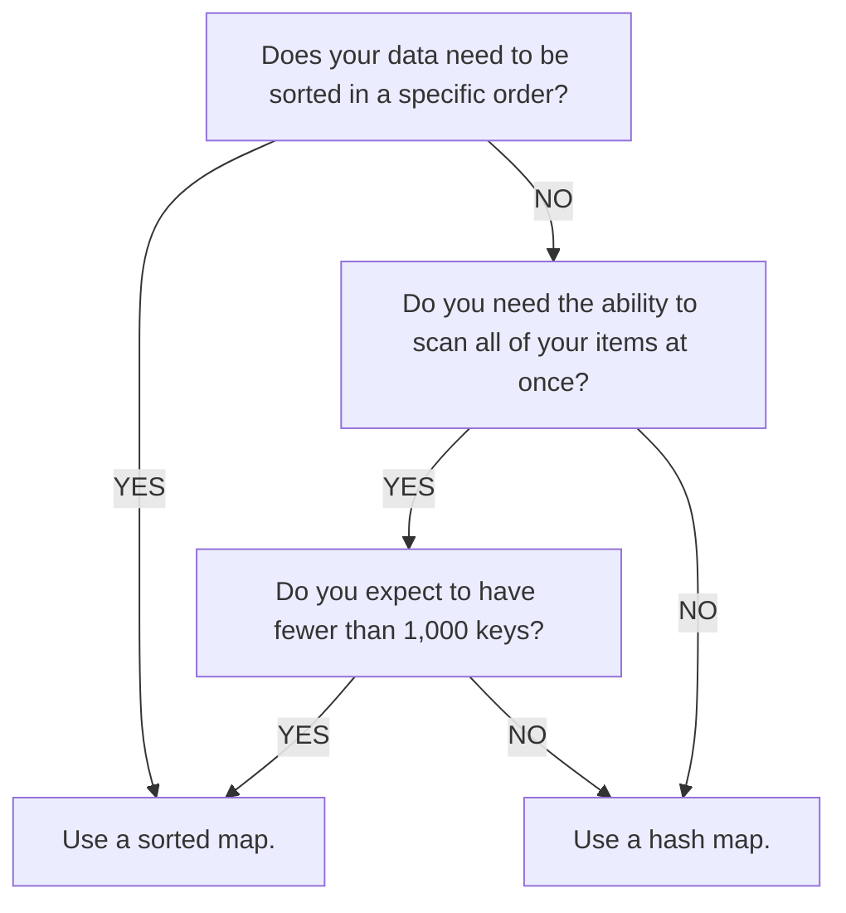

*Explains how to implement memory store data structures to store frequent in-memory data.*

[[30 Official Roblox Docs/API Reference/Classes/MemoryStoreService|MemoryStoreService]] is a high throughput and low latency data service that provides fast in-memory data storage accessible from all servers in a live session. **Memory Stores** are suitable for frequent and ephemeral data that change rapidly and don't need to be durable, because they are faster to access and vanish when reaching the maximum lifetime. For data that needs to persist across sessions, use [[30 Official Roblox Docs/Cloud Services/Data Stores/Data stores|data stores]].

## Data structures

Instead of directly accessing raw data, memory stores have three primitive data structures shared across servers for quick processing: [[30 Official Roblox Docs/Cloud Services/Memory Stores/Memory store sorted map|sorted map]], [[30 Official Roblox Docs/Cloud Services/Memory Stores/Memory store queue|queue]], and [[30 Official Roblox Docs/Cloud Services/Memory Stores/Memory store hash map|hash map]]. Each data structure is a good fit for certain use cases:

- **Skill-based matchmaking** - Save user information, such as skill level, in a shared **queue** among servers, and use lobby servers to run matchmaking periodically.
- **Cross-server trading and auctioning** - Enable universal trading between different servers, where users can bid on items with real-time changing prices, with a **sorted map** of key-value pairs.
- **Global leaderboards** - Store and update user rankings on a shared leaderboard inside a **sorted map**.
- **Shared inventories** - Save inventory items and statistics in a shared **hash map**, where users can utilize inventory items concurrently with one another.
- **Cache for Persistent Data** - Sync and copy your persistent data in a data store to a memory store **hash map** that can act as a cache and improve your game's performance.

In general, if you need to access data based on a specific key, use a hash map. If you need that data to be ordered, use a sorted map. If you need to process your data in a specific order, use a queue.

## Limits and quotas

To maintain the scalability and system performance, memory stores have data usage quotas for the memory size, API requests, and the data structure size.

Memory stores have an eviction policy based on expiration time, also known as time to live (TTL). Items are evicted after they expire, and memory quota is freed up for new entries. When you hit the memory limit, requests that increase memory usage fail until you free up memory or increase your quota. See [[30 Official Roblox Docs/Cloud Services/Memory Stores/Memory stores#Recover from memory quota exhaustion|Recover from memory quota exhaustion]] for options.

### Memory size quota

The memory quota limits the total amount of memory that a game can consume. It's not a fixed value; instead, it changes over time depending on the number of users in the game according to the formula **64 KB + 1.2 KB \* [number of users]**. The quota applies on the game level instead of the server level.

When users join the game, the additional memory quota is available immediately. When users leave the game, the quota doesn't reduce immediately. There's a traceback period of eight days before the quota reevaluates to a lower value.

After your game hits the memory size quota, any API requests that increase the memory size always fail. Requests that decrease or don't change the memory size still succeed.

With the [[30 Official Roblox Docs/Cloud Services/Memory Stores/Memory store observability|observability]] dashboard, you can view the memory size quota of your game in real time using the **Memory Usage** chart.

### API request limits

A **request unit** quota applies to all [[30 Official Roblox Docs/API Reference/Classes/MemoryStoreService|MemoryStoreService]] API calls. This quota is **1000 + 120 \* [number of concurrent users]** request units per minute.

Most API calls only consume one request unit, with a few exceptions:

- [[30 Official Roblox Docs/API Reference/Classes/MemoryStoreSortedMap#GetRangeAsync|MemoryStoreSortedMap:GetRangeAsync()]]

  Consumes units based on the number of returned items. For example, if this method returns 10 items, the call counts as 10 request units. If it returns an empty response, it counts as one request unit.

- [[30 Official Roblox Docs/API Reference/Classes/MemoryStoreQueue#ReadAsync|MemoryStoreQueue:ReadAsync()]]

  Consumes units based on the number of returned items, just like `MemoryStoreSortedMap:GetRangeAsync()`, but consumes an additional unit every two seconds while reading. Specify the maximum read time with the `waitTimeout` parameter.

- [[30 Official Roblox Docs/API Reference/Classes/MemoryStoreHashMap#UpdateAsync|MemoryStoreHashMap:UpdateAsync()]]

  Consumes a minimum of two units.

- [[30 Official Roblox Docs/API Reference/Classes/MemoryStoreHashMap#ListItemsAsync|MemoryStoreHashMap:ListItemsAsync()]]

  Consumes **[number of partitions scanned] + [items returned]** units.

The requests quota is also applied on the game level instead of the server level. This provides flexibility to allocate the requests among servers as long as the total request rate does not exceed the quota. If you exceed the quota, you receive an error response when the service throttles your requests.

With the [[30 Official Roblox Docs/Cloud Services/Memory Stores/Memory store observability|observability]] feature available, you can view the request unit quota of your game in real time.

### Data structure size limits

For a single sorted map or queue, the following size and item count limits apply:

- Maximum number of items: 1,000,000
- Maximum total size (including keys for sorted map): 100 MB

### Per-partition limits

In addition to the game-level [[30 Official Roblox Docs/Cloud Services/Memory Stores/Memory stores#API request limits|request unit quota]], memory stores apply request limits to each partition as a safeguard that protects the stability of the service for all games. These limits aren't a quota that your game is allocated, and they aren't a hard ceiling on the throughput your game can achieve. The following values are estimates. They are configured on the Roblox backend and can change, so don't design against them as fixed numbers.

Every request counts toward the limit of the [[30 Official Roblox Docs/Cloud Services/Memory Stores/Partitions and data distribution#Partitions|partition]] that holds the item, whatever the data structure. You can currently expect throttling to begin at roughly **30,000 request units per minute** for a single partition, so aim to stay well below that rate. How much of that limit a data structure consumes depends on how its items are distributed:

- **Sorted maps and queues** each reside on a single partition, so every request to one of these data structures counts toward the same partition limit.
- **Hash maps** spread their items across many partitions, so traffic spread across many item keys rarely approaches the limit of any one partition.

Hash maps have an additional limit on each item key of approximately **5,000 write request units per minute** and **15,000 read request units per minute**. This per-key limit applies on top of the per-partition limit, so a frequently accessed key can hit either one. The per-key limit applies only to single-key operations: the read limit applies to [[30 Official Roblox Docs/API Reference/Classes/MemoryStoreHashMap#GetAsync|MemoryStoreHashMap:GetAsync()]], the write limit applies to [[30 Official Roblox Docs/API Reference/Classes/MemoryStoreHashMap#SetAsync|MemoryStoreHashMap:SetAsync()]] and [[30 Official Roblox Docs/API Reference/Classes/MemoryStoreHashMap#RemoveAsync|MemoryStoreHashMap:RemoveAsync()]], and [[30 Official Roblox Docs/API Reference/Classes/MemoryStoreHashMap#UpdateAsync|MemoryStoreHashMap:UpdateAsync()]] counts against both the read and write limits. [[30 Official Roblox Docs/API Reference/Classes/MemoryStoreHashMap#ListItemsAsync|MemoryStoreHashMap:ListItemsAsync()]] scans partitions rather than a single key, so only the per-partition limit applies to it.

*(image in the full Top G Vault)*

If you don't need sorting or first-in, first-out functionality, a hash map is usually the best choice because it can spread load across partitions.

When requests exceed a partition or per-key limit, the service throttles them and returns a `PartitionRequestsOverLimit` status code, which you can monitor with the [[30 Official Roblox Docs/Cloud Services/Memory Stores/Memory store observability|observability]] dashboard.

If you expect a data structure or an item key to receive a high, sustained request rate, [[30 Official Roblox Docs/Cloud Services/Memory Stores/Best practices for memory stores#Distribute load with sharding|shard]] it so that the load spreads across more partitions or keys. Spread reads and writes evenly across multiple item keys to stay within per-key limits. You can also reduce the request rate by caching values on the server and rechecking them after an interval, batching requests where possible, and applying [exponential backoff](https://en.wikipedia.org/wiki/Exponential_backoff) when you receive throttling responses.

> [!info]
> We strive to be as transparent as possible about rate limits, but additional, undocumented limits might apply, including for DDoS protection and service stability. Always ensure your game handles throttling responses. See [[30 Official Roblox Docs/Cloud Services/Memory Stores/Memory stores#Troubleshooting|Troubleshooting]] for guidance.
>
> If you hit an undocumented rate limit that blocks your use case (or you would like higher limits), leave feedback explaining your needs in the [Developer Forum](https://devforum.roblox.com/).

## Recover from memory quota exhaustion

If your game receives `TotalMemoryOverLimit` errors, check the **Memory Usage** chart in the [[30 Official Roblox Docs/Cloud Services/Memory Stores/Memory store observability|observability dashboard]]. To resume writes that increase memory usage, delete unneeded items, wait for items to expire, or use one of the following options.

### Flush memory stores with Open Cloud

If you no longer need the stored data, use the Open Cloud [Flush Memory Store](https://create.roblox.com/docs/cloud/reference/features/storage#Cloud_FlushMemoryStore) endpoint to asynchronously clear all memory store data structures in a universe for the selected scope.

> [!warning]
> A flush clears all queues, sorted maps, and hash maps in the selected scope, not just an individual data structure. This includes data that live features such as matchmaking or trading might still need. Only flush when your game can operate without that data.

To flush memory stores:

1. [[30 Official Roblox Docs/Cloud/Auth/Manage API keys|Create an API key]] with permissions to flush memory stores and get the flush operation status for the target universe.
2. Send a `POST` request to `https://apis.roblox.com/cloud/v2/universes/{universe_id}/memory-store:flush` with the API key in the `x-api-key` header. Replace `{universe_id}` with your game's universe ID. Set the `scope` query parameter to `LIVE` for production data or `TEST` for Studio data. If you omit `scope`, the endpoint uses `LIVE`.
3. Use [Get Memory Store Flush Operation](https://create.roblox.com/docs/cloud/reference/features/storage#Cloud_GetMemoryStoreFlushOperation) to poll the operation returned by the flush request until `done` is `true`, and check for an `error`. Use the same scope when polling. The returned `path` already includes `cloud/v2`, so poll at `https://apis.roblox.com/{path}` without adding another prefix.

Studio and production memory stores are [[30 Official Roblox Docs/Cloud Services/Memory Stores/Memory stores#Test and debug in Studio|isolated]]. Flushing one scope doesn't clear the other. After clearing unneeded data, follow the [[30 Official Roblox Docs/Cloud Services/Memory Stores/Memory stores#Best practices|best practices]], such as shorter expiration times and explicit deletion, to prevent memory usage from reaching the quota again.

### Increase capacity with Extended Services

If your game needs to retain the data and use more storage than the default quota allows, enable [[30 Official Roblox Docs/Cloud Services/Extended Services|Extended Services]] for memory stores. Extended Services lets you pay for memory store storage and requests beyond the default quotas.

To get started, meet the [[30 Official Roblox Docs/Cloud Services/Extended Services#Eligibility requirements|eligibility requirements]], add account details and a payment method, then select your game in the [Creator Dashboard](https://create.roblox.com/dashboard/creations). Under **Extended Services**, enable memory stores and set monthly budgets for the resources you need. See [[30 Official Roblox Docs/Cloud Services/Extended Services#Enable a service|Enable a service]] and [[30 Official Roblox Docs/Cloud Services/Extended Services#Service pricing|Service pricing]] for details.

Extended Services throttles the service if usage exceeds your budget. Monitor usage and billing, and continue to [[30 Official Roblox Docs/Cloud Services/Memory Stores/Memory stores#Best practices|remove unneeded data]].

## Best practices

To keep your memory usage pattern optimal and avoid hitting the [[30 Official Roblox Docs/Cloud Services/Memory Stores/Memory stores#Limits and quotas|limits]], follow these best practices:

- **Remove processed items.** Consistently cleaning up read items using [[30 Official Roblox Docs/API Reference/Classes/MemoryStoreQueue#RemoveAsync|MemoryStoreQueue:RemoveAsync()]] method for queues and [[30 Official Roblox Docs/API Reference/Classes/MemoryStoreSortedMap#RemoveAsync|MemoryStoreSortedMap:RemoveAsync()]] for sorted maps can free up memory and keep the data structure up-to-date.

- **Set the expiration time to the smallest time frame possible when adding data.** Though the default expiration time is 45 days for both [[30 Official Roblox Docs/API Reference/Classes/MemoryStoreQueue#AddAsync|MemoryStoreQueue:AddAsync()]] and [[30 Official Roblox Docs/API Reference/Classes/MemoryStoreSortedMap#SetAsync|MemoryStoreSortedMap:SetAsync()]], setting the shortest possible time can automatically clean up old data to prevent them from filling up your memory usage quota.
  - Don't store a large amount of data with a long expiration, as it risks exceeding your memory quota and potentially causing issues that can break your entire game.
  - Always either explicitly delete unneeded items or set a short item expiration.
  - Generally, you should use explicit deletion for releasing memory and item expiration as a safety mechanism to prevent unused items from occupying memory for an extended period of time.

- Only keep necessary values in memory.

  For example, for an auction house game, you only need to maintain the highest bid. You can use [[30 Official Roblox Docs/API Reference/Classes/MemoryStoreSortedMap#UpdateAsync|MemoryStoreSortedMap:UpdateAsync()]] on one key to keep the highest bid rather than keeping all bids in your data structure.

- Use [exponential backoff](https://en.wikipedia.org/wiki/Exponential_backoff) to help stay below API request limits.

  For example, if you receive a `DataUpdateConflict`, you might retry after two seconds, then four, eight, etc. rather than constantly sending requests to [[30 Official Roblox Docs/API Reference/Classes/MemoryStoreService|MemoryStoreService]] to get the correct response.

- Split giant data structures into multiple smaller ones by [sharding](https://en.wikipedia.org/wiki/Shard_(database_architecture)).

  It's often easier to manage data in smaller structures rather than storing everything in one large data structure. This approach can also help avoid usage and rate limits. For example, if you have a sorted map that uses prefixes for its keys, consider separating each prefix into its own sorted map. For an especially popular game, you might even separate users into multiple maps based on the last digits of their user IDs.

- [[30 Official Roblox Docs/Cloud Services/Memory Stores/Best practices for memory stores|Shard]] frequently accessed keys in hash maps with multiple copies of the key to distribute load.

- Compress stored values.

  For example, consider using the [LZW](https://en.wikipedia.org/wiki/Lempel%E2%80%93Ziv%E2%80%93Welch) algorithm to reduce the stored value size.

- **Enroll in Extended Services.**

  For storage or request usage beyond the default quotas, [[30 Official Roblox Docs/Cloud Services/Memory Stores/Memory stores#Increase capacity with Extended Services|enable Extended Services for memory stores]].

## Observability

The [[30 Official Roblox Docs/Cloud Services/Memory Stores/Memory store observability|Observability Dashboard]] provides insights and analytics for monitoring and troubleshooting your memory store usage. With real-time updating charts on different aspects of your memory usage and API requests, you can track the memory usage pattern of your game, view the current allocated quotas, monitor the API status, and identify potential issues for performance optimization.

The following table lists and describes all status codes of API responses available on the Observability Dashboard's **Request Count by Status** and **Requests by API x Status** charts. For more information on how to resolve these errors, see [[30 Official Roblox Docs/Cloud Services/Memory Stores/Memory stores#Troubleshooting|Troubleshooting]]. For the specific quota or limit that an error relates to, see [[30 Official Roblox Docs/Cloud Services/Memory Stores/Memory stores#Limits and quotas|Limits and Quotas]].

| Status code | Description |
| --- | --- |
| Success | Success. |
| DataStructureMemoryOverLimit | Exceeds data structure level memory size limit (100 MB). |
| DataUpdateConflict | Conflict due to concurrent update. |
| AccessDenied | Unauthorized to access game data. This request doesn't consume request units or use quota. |
| InternalError | Internal error. |
| InvalidRequest | The request doesn't have required information or has malformed information. |
| DataStructureItemsOverLimit | Exceeds data structure level item count limit (1M). |
| NoItemFound | No item found in [[30 Official Roblox Docs/API Reference/Classes/MemoryStoreQueue#ReadAsync\|MemoryStoreQueue:ReadAsync()]] or [[30 Official Roblox Docs/API Reference/Classes/MemoryStoreSortedMap#UpdateAsync\|MemoryStoreSortedMap:UpdateAsync()]]. `ReadAsync()` polls every 2 seconds and returns this status code until it finds items in the queue. |
| DataStructureRequestsOverLimit | Exceeds data structure level request unit limit (100,000 request units per minute). |
| PartitionRequestsOverLimit | Exceeds a [[30 Official Roblox Docs/Cloud Services/Memory Stores/Memory stores#Per-partition limits\|per-partition or per-key request unit limit]]. |
| TotalRequestsOverLimit | Exceeds universe-level request unit limit. |
| TotalMemoryOverLimit | Exceeds universe-level memory quota. |
| ItemValueSizeTooLarge | Value size exceeds limit (32 KB). |

The following table lists states codes from client side, which are currently not available on the Observability Dashboard.

| Status code | Description |
| --- | --- |
| InternalError | Internal Error. |
| UnpublishedPlace | You must publish this place to use MemoryStoreService. |
| InvalidClientAccess | MemoryStoreService must be called from server. |
| InvalidExpirationTime | The field 'expiration' time must be between 0 and 3,888,000. |
| InvalidRequest | Unable to convert value to json. |
| InvalidRequest | Unable to convert sortKey to a valid number or string. |
| TransformCallbackFailed | Failed to invoke transformation callback function. |
| RequestThrottled | Recent MemoryStores requests hit one or more limits. |
| UpdateConflict | Exceeded max number of retries. |

### Troubleshooting

The following table lists and describes the recommended solution for each response status code:

| Error | Troubleshooting options |
| --- | --- |
| DataStructureRequestsOverLimit / PartitionRequestsOverLimit | • Add a local cache by saving information to another variable and rechecking after a certain time interval, such as 30 seconds. • Use the **Request Count by Status** chart to verify that you are receiving more **Success** responses than **NoItemFounds**. Limit the amount of times you hit [[30 Official Roblox Docs/API Reference/Classes/MemoryStoreService\|MemoryStoreService]] with a failed request. • Implement a short delay between requests. • Follow the [[30 Official Roblox Docs/Cloud Services/Memory Stores/Memory stores#Best practices\|best practices]], including: |
| TotalRequestsOverLimit |  |
| DataStructureItemsOverLimit | • Apply [[30 Official Roblox Docs/Cloud Services/Memory Stores/Memory stores#Best practices\|best practices]] on reducing the memory size. |
| DataStructureMemoryOverLimit |  |
| TotalMemoryOverLimit | • Delete unneeded items or wait for them to expire. See [[30 Official Roblox Docs/Cloud Services/Memory Stores/Memory stores#Best practices\|best practices]]. • If your game can operate without the stored data, [[30 Official Roblox Docs/Cloud Services/Memory Stores/Memory stores#Flush memory stores with Open Cloud\|flush memory stores with Open Cloud]]. • If your game needs more storage, [[30 Official Roblox Docs/Cloud Services/Memory Stores/Memory stores#Increase capacity with Extended Services\|increase capacity with Extended Services]]. |
| DataUpdateConflict | • Implement a short delay between requests to avoid multiple requests updating the same key at the same time. • For sorted maps, use the callback function on the [[30 Official Roblox Docs/API Reference/Classes/MemoryStoreSortedMap#UpdateAsync\|MemoryStoreSortedMap:UpdateAsync()]] method to abort a request after a certain number of attempts, as the following code sample shows: • Investigate to see if you're calling [[30 Official Roblox Docs/API Reference/Classes/MemoryStoreService\|MemoryStoreService]] efficiently to avoid conflicts. Ideally, you shouldn't over-send requests. • Consistently remove items once they are read using the [[30 Official Roblox Docs/API Reference/Classes/MemoryStoreQueue#RemoveAsync\|MemoryStoreQueue:RemoveAsync()]] method for queues and [[30 Official Roblox Docs/API Reference/Classes/MemoryStoreSortedMap#RemoveAsync\|MemoryStoreSortedMap:RemoveAsync()]] for sorted maps. |
| Internal Error | • Check the [Roblox status page](https://status.roblox.com/pages/59db90dbcdeb2f04dadcf16d). • File a [bug report](https://devforum.roblox.com/t/how-to-post-a-bug-report/24388) describing the issue with your game's Universe ID. |
| InvalidRequest | • Make sure that you include correct and valid parameters in your request. Examples of invalid parameters include: |
| ItemValueSizeTooLarge | • Shard or split the item value into multiple keys. • Encoding or compressing stored values. |

## Test and debug in Studio

The data in [[30 Official Roblox Docs/API Reference/Classes/MemoryStoreService|MemoryStoreService]] is isolated between Studio and production, so changing the data in Studio doesn't affect production behavior. This means that your API calls from Studio don't access production data, allowing you to safely test memory stores and new features before going to production.

Studio testing has the same [[30 Official Roblox Docs/Cloud Services/Memory Stores/Memory stores#Limits and quotas|limits and quotas]] as production. For quotas calculated based on the number of users, the resulting quota can be very small since you are the only user for Studio testing. When testing from Studio, you might also notice slightly higher latency and elevated error rates compared to usage in production due to some additional checks that are performed to verify access and permissions.

For information on how to debug a memory store on live games or when testing in studio, use [[30 Official Roblox Docs/Studio/Developer Console|Developer Console]].

---
*Source: [Memory stores](https://create.roblox.com/docs/cloud-services/memory-stores) (Roblox Creator Docs). © Roblox Corporation, licensed CC BY 4.0; code samples MIT. Converted for Obsidian; changes: formatting only.*
