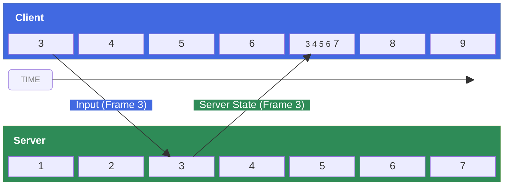

*The server authority model lets you build responsive cheat-free competitive games such as FPS, racing, sports, and combat.*

In a **server authority model**, the server is the single **source of truth** for the entire game state, and clients are only trusted to report their own inputs. This architecture is the core netcode foundation of a fair, competitive game because it prevents entire classes of cheating like flyhacks or speedhacks by never trusting a client to report its own position or state.

## Advantages

In a naive server-owned system, clients would simply send their inputs to the server and display the results of the game sent back by the server. While technically correct, such a system would face significant **input latency** because every player action would have to travel to the server, be processed, and have the result sent back to the client before it could be displayed. For most games, especially those fast‑paced, that round‑trip delay would cause gameplay to feel laggy, unresponsive, and unplayable.

In Roblox's **server authority** model, latency is compensated for by having clients instantly [[30 Official Roblox Docs/Projects/Server Authority/Server authority model#Client prediction|predict]] the effects of their inputs in addition to sending them to the server. For example, when a player presses a key, the client doesn't wait for the server to respond; instead it **predicts** a few frames ahead of the last known server state. This allows the client to show the result of the input action instantly, effectively hiding network latency and making the game feel responsive.

Sometimes the client will get its prediction wrong ([[30 Official Roblox Docs/Projects/Server Authority/Server authority model#Client misprediction|misprediction]]) and, because of network latency, the client will not know that it has made a mistake for a few frames. For example:

> [!warning]
> Your client predicts that you've moved forward, but on the server another player used a stun ability that stopped you from moving. The client and server now have different states.

When a misprediction is detected, the client must correct its prediction based on the server's **authoritative state**. If the authoritative state is different from the client's predicted state, the client must [[30 Official Roblox Docs/Projects/Server Authority/Server authority model#Rollback and resimulation|roll back and resimulate]] its predicted frames. This system of client‑side prediction, rollback, and resimulation is known as "latency compensation" and helps make server‑authoritative multiplayer games feel smooth and responsive.

> [!info]
> Mispredictions are a **normal and expected** part of the server authority architecture because clients inherently cannot predict other players' inputs, so actions by other players will always trigger some amount of misprediction. When tuned correctly, the resulting corrections are small and should be imperceptible to players. Read further on [[30 Official Roblox Docs/Projects/Server Authority/Server authority techniques|advanced techniques]] to smooth out and mask network artifacts.

## Setup

The server authority model requires certain other engine technologies to function correctly. Confirm the following property settings on the [[30 Official Roblox Docs/API Reference/Classes/Workspace|Workspace]] object in the [[30 Official Roblox Docs/Studio/Explorer window|Explorer]]:

1. [[30 Official Roblox Docs/API Reference/Classes/Workspace#AuthorityMode|Workspace.AuthorityMode]] must be [[30 Official Roblox Docs/API Reference/Enums/AuthorityMode|Server]] (setting this automatically sets the following five).
2. [[30 Official Roblox Docs/API Reference/Classes/Workspace#NextGenerationReplication|Workspace.NextGenerationReplication]] must be enabled.
3. [[30 Official Roblox Docs/API Reference/Classes/Workspace#PlayerScriptsUseInputActionSystem|Workspace.PlayerScriptsUseInputActionSystem]] must be enabled.
4. [[30 Official Roblox Docs/API Reference/Classes/Workspace#SignalBehavior|Workspace.SignalBehavior]] must be [[30 Official Roblox Docs/API Reference/Enums/SignalBehavior|Deferred]].
5. [[30 Official Roblox Docs/API Reference/Classes/Workspace#UseFixedSimulation|Workspace.UseFixedSimulation]] must be enabled.
6. [[30 Official Roblox Docs/API Reference/Classes/Workspace#StreamingEnabled|Workspace.StreamingEnabled]] must be enabled.

## Concepts

The server authority system runs on a few core concepts as follows.

### Client prediction

Through **client prediction**, the client simulates a few frames ahead of the last known server state to predict the effects of player inputs immediately. This hides input latency, but the prediction may later turn out to be incorrect ([[30 Official Roblox Docs/Projects/Server Authority/Server authority model#Client misprediction|client misprediction]]) and thus require correction. The client tries to simulate just far enough ahead of the last known authoritative server state so that its inputs arrive on the server at the intended frame. The number of frames the client will predict ahead of the known server state is based on the latency behind the client and server.

### Client misprediction

When the client receives the authoritative state from the server, it checks that state against a historical record of what it predicted locally for that frame. When there is a difference between what the client [[30 Official Roblox Docs/Projects/Server Authority/Server authority model#Client prediction|predicted]] and what the server actually did, this is a **misprediction**. Mispredictions can occur for several reasons, including shifts in network latency, other players acting in ways the client didn't anticipate, the game running certain logic exclusively on the server, etc.

If the authoritative state is different from the client's predicted state, the client must [[30 Official Roblox Docs/Projects/Server Authority/Server authority model#Rollback and resimulation|roll back and resimulate]].

### Rollback and resimulation

When a client detects a [[30 Official Roblox Docs/Projects/Server Authority/Server authority model#Client misprediction|misprediction]], it must reset to the server's authoritative state and then resimulate to jump back to its predicted frame. Based on the network latency, the client tries to simulate just far enough ahead of the last known authoritative server state so that its inputs arrive on the server at the intended frame.



*In the above diagram, the client is simulating 2 frames ahead of the server. It sends its inputs for frame 3 which arrive at the intended frame (3) on the server. The server sends the authoritative state for frame 3 and the client receives it on frame 7. The client discovers it mispredicted frame 3 so it resets to the server's frame 3 and resimulates frames 4, 5 and 6 before it simulates frame 7. Players may see a noticeable network artifact such as a sudden movement.*

In summary, the **client**:

1. Receives the **authoritative state** from the server and compares it against its own **predicted state**.
2. If the client's prediction was incorrect:
   1. Client rolls back to the last known authoritative state received from the server.
   2. Client resimulates from the authoritative state to its predicted state, re-applying any local inputs.

## Implementation

### Network ownership and prediction

In the server authority model, you're able to keep the core gameplay objects server‑owned without incurring the input latency cost normally associated with server ownership. Things like cars, player characters, or other gameplay‑critical objects can remain server‑owned, even when interacting with other players.

By default, Roblox will automatically predict properties with [[30 Official Roblox Docs/Projects/Server Authority/Server authority model#Simulation access|simulation access]] near the local player [[30 Official Roblox Docs/API Reference/Classes/Player#Character|Character]], but if you want more fine‑grained control, you can explicitly force an instance's prediction on or off with [[30 Official Roblox Docs/API Reference/Classes/RunService#SetPredictionMode|RunService:SetPredictionMode()]].

### Simulation sync

In the server authority model, the client and the server must both run the core simulation, and the client's simulation needs to be able to [[30 Official Roblox Docs/Projects/Server Authority/Server authority model#Rollback and resimulation|roll back and resimulate]] when a [[30 Official Roblox Docs/Projects/Server Authority/Server authority model#Client misprediction|misprediction]] occurs. To enable this, write your core logic inside functions bound through [[30 Official Roblox Docs/API Reference/Classes/RunService#BindToSimulation|RunService:BindToSimulation()]] in a [[30 Official Roblox Docs/API Reference/Classes/ModuleScript|ModuleScript]] that's initialized on both the client and server.

*(image in the full Top G Vault)*

During a resimulation, Roblox will re-run the functions bound to the simulation via [[30 Official Roblox Docs/API Reference/Classes/RunService#BindToSimulation|BindToSimulation()]]. Processing player inputs, interacting with synchronized physics objects, and updating the core game state should live inside those bound functions.

Use [[30 Official Roblox Docs/API Reference/Globals/Roblox globals#time|time()]] for any time-based logic inside a bound simulation function, such as driving an animation speed or oscillating a value over time. When [[30 Official Roblox Docs/API Reference/Classes/Workspace#AuthorityMode|Workspace.AuthorityMode]] is [[30 Official Roblox Docs/API Reference/Enums/AuthorityMode|Enum.AuthorityMode.Server]], `time()` is synchronized between the client and the server and uses fixed-step simulation time. During [[30 Official Roblox Docs/Projects/Server Authority/Server authority model#Rollback and resimulation|resimulation]], it rewinds to the authoritative frame and advances as the client replays frames, so it returns a consistent value each time a frame is simulated.

> [!warning]
> Other time functions don't share this behavior. [[30 Official Roblox Docs/API Reference/Globals/Roblox globals#tick|tick()]] and [[30 Official Roblox Docs/API Reference/Libraries/os#time|os.time()]] read the local device clock, while [[30 Official Roblox Docs/API Reference/Libraries/os#clock|os.clock()]] measures elapsed time from an arbitrary local baseline. They aren't synchronized between the client and the server and don't roll back during resimulation, so avoid them for simulation-affecting logic.

#### Simulation

[[30 Official Roblox Docs/API Reference/Classes/ModuleScript|ModuleScript]] named `Simulation` in [[30 Official Roblox Docs/API Reference/Classes/ReplicatedStorage|ReplicatedStorage]]:

```lua title="Simulation"
local RunService = game:GetService("RunService")
local Players = game:GetService("Players")

local Simulation = {}

Simulation.Initialize = function()
	RunService:BindToSimulation(function(deltaTime)
		-- Read player inputs
		-- Update game state
	end)
end

return Simulation
```

#### ServerLoader

[[30 Official Roblox Docs/API Reference/Classes/Script|Script]] named `ServerLoader` as child of the `Simulation` [[30 Official Roblox Docs/API Reference/Classes/ModuleScript|ModuleScript]]:

```lua title="ServerLoader"
local Simulation = require(script.Parent)

Simulation:Initialize()
```

#### ClientLoader

[[30 Official Roblox Docs/API Reference/Classes/LocalScript|LocalScript]] named `ClientLoader` as child of the `Simulation` [[30 Official Roblox Docs/API Reference/Classes/ModuleScript|ModuleScript]]:

```lua title="ClientLoader"
local Simulation = require(script.Parent)

Simulation:Initialize()
```

### State sync with attributes

Roblox automatically synchronizes all properties with [[30 Official Roblox Docs/Projects/Server Authority/Server authority model#Simulation access|simulation access]] on predicted instances. For custom data, [[30 Official Roblox Docs/Studio/Properties window#Instance attributes|attributes]] are the primary way to synchronize instances marked as predicted; on such instances, any mismatch in attribute values between the server's source of truth and the client's prediction will trigger a full [[30 Official Roblox Docs/Projects/Server Authority/Server authority model#Rollback and resimulation|rollback and resimulation]].

> [!success]
> Use attributes to store game data that affects your core simulation, including player health, ammunition, inventory, or custom rules (see [[30 Official Roblox Docs/Projects/Server Authority/Server authority model#Attribute limits|limitations]]).

> [!warning]
> Only write to attributes on **predicted** instances from within functions bound through [[30 Official Roblox Docs/API Reference/Classes/RunService#BindToSimulation|BindToSimulation()]] to ensure that Roblox can fully track relevant game states and resimulate properly.

#### Attribute limits

In order to be replicated, an attribute must meet all of the following criteria:

- It is among the first 64 attributes on its [[30 Official Roblox Docs/API Reference/Classes/Instance|Instance]].
- Its name contains at most 50 characters.
- If a string type attribute, its value contains at most 50 characters.

#### Simulation access

Many properties and methods in the engine API reference include the **Simulation Access** label, for example [[30 Official Roblox Docs/API Reference/Classes/BasePart#CFrame|BasePart.CFrame]]. Properties with this label will be predicted by the server authority system. Additionally, only properties and methods with this label can be accessed inside functions bound with [[30 Official Roblox Docs/API Reference/Classes/RunService#BindToSimulation|RunService:BindToSimulation()]].

> [!warning]
> Simulation restrictions apply based on when code runs, not which Luau thread runs it. Because [[30 Official Roblox Docs/API Reference/Libraries/task#spawn|task.spawn()]] resumes code immediately, calling it from [[30 Official Roblox Docs/API Reference/Classes/RunService#BindToSimulation|BindToSimulation()]] runs the new thread during simulation and keeps the simulation restrictions. Use [[30 Official Roblox Docs/API Reference/Libraries/task#defer|task.defer()]] to schedule code outside simulation and its restrictions.

### Input actions

In a server-authoritative game, the primary way for a client to affect the game's state is through the [[30 Official Roblox Docs/Input/Input Action System|Input Action System]]. These inputs are sent to the server and are replayed during resimulation on the client. As a result, [[30 Official Roblox Docs/API Reference/Classes/InputAction|InputActions]] should be used for **all inputs that affect the core simulation** and they should be checked for sanity before they're processed.

> [!warning]
> To reiterate, do not use traditional events like [[30 Official Roblox Docs/API Reference/Classes/UserInputService#InputBegan|UserInputService.InputBegan]] in the core simulation of a server-authoritative game.

Note that [[30 Official Roblox Docs/API Reference/Classes/InputContext|InputContexts]] must be a descendent of a [[30 Official Roblox Docs/API Reference/Classes/Player|Player]] so that the engine knows who has ownership over the [[30 Official Roblox Docs/API Reference/Classes/InputContext|InputContext]]. One approach is to add your [[30 Official Roblox Docs/API Reference/Classes/InputContext|InputContexts]] to a folder under [[30 Official Roblox Docs/API Reference/Classes/ReplicatedStorage|ReplicatedStorage]] and use a [[30 Official Roblox Docs/API Reference/Classes/Script|Script]] under [[30 Official Roblox Docs/API Reference/Classes/ServerScriptService|ServerScriptService]] to clone the [[30 Official Roblox Docs/API Reference/Classes/InputContext|InputContexts]] per player:

*(image in the full Top G Vault)*

```lua title="InputSetup"
local Players = game:GetService("Players")
local ReplicatedStorage = game:GetService("ReplicatedStorage")

local InputsFolder = ReplicatedStorage:WaitForChild("Inputs")

local function onPlayerAdded(player)
	local clone = InputsFolder:Clone()
	clone.Parent = player
end

Players.PlayerAdded:Connect(onPlayerAdded)

for _, player in Players:GetPlayers() do
	onPlayerAdded(player)
end
```

Using this pattern, you can read [[30 Official Roblox Docs/API Reference/Classes/InputAction|InputActions]] for all players in [[30 Official Roblox Docs/API Reference/Classes/RunService#BindToSimulation|RunService:BindToSimulation()]] on both client and server to receive the same data for a given frame and record the previous frame's input in an [[30 Official Roblox Docs/Studio/Properties window#Instance attributes|attribute]], for example to trigger a character run when a `RunAction` input action is triggered.

### Remote events

[[30 Official Roblox Docs/Scripting/Events/Remote events and callbacks|Remote events]] can still be used within the server authority model to facilitate discrete communication between client and server. For example, servers can use remote events to broadcast data about players scoring points or picking up objects, and clients can use remote events as an alternative API for sending inputs to the server, such as for button presses or tapping objects in the 3D world.

> [!warning]
> [[30 Official Roblox Docs/API Reference/Classes/RemoteEvent|RemoteEvents]] might not be consistently ordered with property and attribute updates over the network. For example, if you change a property before firing a remote event on a client, the server might receive the property change after the remote event. To learn more, see [[30 Official Roblox Docs/Scripting/Properties and attributes#Replication order|replication order]].

### Animations, sounds, and effects

Client-side effects like animations and sounds must be written knowing that the client simulation is merely a prediction of the authoritative server state. [[30 Official Roblox Docs/API Reference/Classes/RunService#BindToSimulation|BindToSimulation()]] limits what properties and methods can be called from within bound functions to help guide you in writing only to the synchronized simulation state. Displaying the results of this simulation, triggering effects and sounds, etc. should be done in a separate function connected to [[30 Official Roblox Docs/API Reference/Classes/RunService#RenderStepped|RenderStepped]] that reads the results of the simulation and triggers the desired effects.

Further guidance around rendering a predicted simulation is covered in the [[30 Official Roblox Docs/Projects/Server Authority/Server authority techniques|advanced techniques]] guide.

## Example projects

In addition to this documentation, the following templates can help you get started:

*(image in the full Top G Vault)* ([link](https://www.roblox.com/games/134686834388911/Racing-Server-Authority-Template))

*Racing*

*(image in the full Top G Vault)* ([link](https://www.roblox.com/games/110687099504272/Soccer-Server-Authority-Template))

*Soccer*

*(image in the full Top G Vault)* ([link](https://www.roblox.com/games/90572444221193/Laser-Tag-Server-Authority-Template))

*Laser Tag*

---
*Source: [Server authority model](https://create.roblox.com/docs/projects/server-authority) (Roblox Creator Docs). © Roblox Corporation, licensed CC BY 4.0; code samples MIT. Converted for Obsidian; changes: formatting only.*
