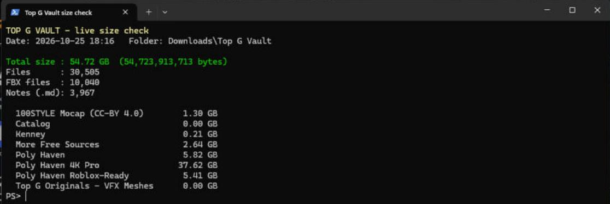

# 👑 Top G Vault: Showcase Edition

**I just Mogged you! - TDOD**

The Roblox game-dev brain in one Obsidian vault: a colour-coded knowledge graph with a cinematic intro, built to take you from idea to shipped game fast.

## 📦 The full vault is 54.7 GB: here's the proof

| Full Top G Vault | |
|---|--:|
| **Total size** | **54.72 GB** |
| **Files** | 30,505 |
| **FBX models + animations** | 10,040 |
| **Notes** | 3,967 |

**This repo is the free showcase (~0.2 GB).** GitHub refuses files over 100 MB and isn't made for 55 GB, so the 3D models, textures and 4K pack live only in the full vault. Every file of the full vault is listed with its exact size in [PROOF/full-vault-file-list.txt](PROOF/full-vault-file-list.txt), with a breakdown in [PROOF/FULL-VAULT-MANIFEST.md](PROOF/FULL-VAULT-MANIFEST.md).

> 🔒 **Can it be edited?** Only the owner (TDODYT) can change this repo. You can download and use the vault, but your copy doesn't change this one. The main branch is protected, and the license does not allow reselling or republishing.

## What's in this repo (free showcase)

| | |
|---|---|
| 📚 **3,880+ notes** | Game design, scripting, networking, performance, combat, AI, vehicles, VFX, UI, monetization, QA, AI tools |
| 🚀 **Fast Game Kit** | Starter-code plan, 30-day ship plan, genre recipes (simulator, tycoon, obby, arena shooter, battlegrounds, open-sea RPG, GTA-lite, medieval, horror) |
| 🧠 **77 deep dives + 600 community-knowledge notes** | Each checked against the official docs; unverified facts are flagged |
| 📖 **Official Roblox Docs mirror** | 993 guide pages, 1,208 API reference notes, Luau language docs (text; images are in the full vault) |
| 🎨 **Colour-coded graph** | 99 topic colours, area-coloured notes, "Top G Vault" graph title |
| 🎵 **Graph intro plugin** | Night-highway hypercar intro with lit signs, then music while the graph is open |
| 🖼️ **Asset catalogs** | Preview thumbnails and tables for every model pack |

### Only in the full Top G Vault (~55 GB)

- **10,000+ FBX files:** 49 Kenney kits, 521 Poly Haven models (1K, 4K and Roblox-ready), 810 motion-capture clips (100STYLE), NASA / Smithsonian / KayKit / OpenGameArt packs, and 22 original VFX meshes
- Every texture, every docs image and every 4K file

## How to open it

1. Install [Obsidian](https://obsidian.md) (free).
2. Download this repo (**Code → Download ZIP**) and unzip it.
3. In Obsidian: **Open folder as vault** → pick the unzipped folder.
4. When asked, choose **Trust author and enable plugins** to get the intro and music.
5. Open `00 START HERE - Top G Vault`, then press **Ctrl+G** for the graph.

> **Sound:** the intro and music stream from YouTube while the graph is open (nothing is downloaded or bundled). Turn them down or off with the player card on the graph or in **Settings → Top G Graph Music**. The intro has its own volume slider.

## Credits and licenses

- Third-party content keeps its own license. The full list and required credits are in `20 FBX Asset Library/Asset Licenses and Credits.md` and `99 Vault Admin/Community Knowledge Credits 2026-10-25.md`.
- **Roblox Creator Docs:** © Roblox Corporation, CC BY 4.0 (code samples MIT). Converted for Obsidian; formatting changes only.
- **Luau docs:** © Roblox Corporation and Lua.org, PUC-Rio, MIT License.
- **100STYLE:** Ian Mason, Sebastian Starke, Taku Komura, CC BY 4.0.
- **NASA:** imagery courtesy of NASA. No endorsement implied.
- Original notes, the plugin and the TDOD logo: see [LICENSE.md](LICENSE.md).

This project is not affiliated with or endorsed by Roblox Corporation.
